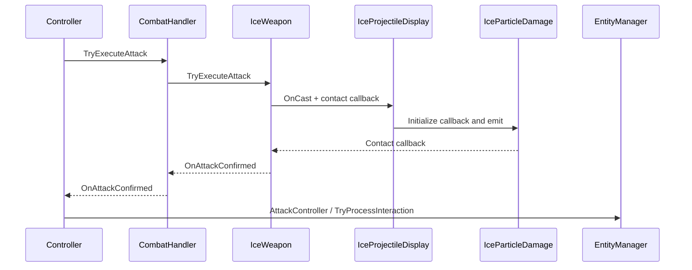

# Ice weapon

Player 1 equips `Assets/Prefab/IceWeapon.prefab`. Test 1 inherits this setup from Player 1; the Enemy Hit Reactions player override also uses it. Imported ParticlePack assets remain unchanged.

## Modules and Actions

- `IceWeapon` validates casts and enforces cooldown. Its `OnCast` event supplies origin, velocity, stats and a cached contact callback.
- `IceProjectileDisplay` owns and emits the particle effect. It passes the callback to `IceParticleDamage`, which reports contacts to its caller and raises `OnImpact` for accepted contacts. Neither component references or attacks a Controller.
- `IceWeapon` resolves the contacted Controller, rejects self hits and invalid combatants, applies weapon consciousness damage and raises the inherited `OnAttackConfirmed` event with target and interaction context.
- `CombatHandler` forwards confirmation to its owning `Controller`, which calls `AttackController` and routes the interaction to EntityManager. The rifle retains its synchronous return path.
- `IceImpactDisplay` listens to `OnImpact` solely for embedded shard decoration.

Callbacks return contact to the weapon without a reference from presentation to the controller. Confirmation subscriptions are paired across enable/disable and weapon replacement. Controller resolves CombatHandler in Awake before subscribing in OnEnable. Cancellation clears the weapon's source; disabling the display clears its particles and contact callback. Impact decoration is optional.

## Prefab setup and tuning

The IceWeapon prefab contains three components: IceWeapon, IceProjectileDisplay and IceImpactDisplay. Its serialized references are already connected. The adapter creates the IceParticleDamage component on the instantiated ParticleSystem root, where Unity sends collision messages.

Configure fire rate, damage and range in IceWeapon’s Stats, and Projectile Speed on IceWeapon. The existing `damagePerBullet` field supplies spell damage; magazine/reload fields are unused. The starter weapon casts six times per second at the main-scene effect’s 80 units/second, with 50-unit range and 5 damage before defense. Casting is unlimited.

Assign the ParticlePack IceLance asset, Effect Scale, Shard Rotation Offset and Hit Mask on IceProjectileDisplay. The effect uses the pack’s ice meshes, materials, mist and collision/death sub-emitters. The casting sphere is hidden; lance meshes and particle children remain visible. Effect Scale is 0.25, reducing flying shards, embedded shards and particle children to one quarter of their original size while preserving variation (0.5–1 instead of 2–4). World-aligned particle rotations face each accepted cast’s velocity, correcting the mesh’s negative-X tip with a 90-degree Y offset. The original randomized roll is preserved. Existing particles retain their own facing when the player aims elsewhere.

The lifetime is range divided by speed. Native particle collision stops ice against scenery and enemies. On collision the flying particle expires and raises OnImpact, which places a persistent embedded shard. The pack’s mist/shatter sub-emitters remain in use. The flying particle is killed on contact, preventing resting contacts. If a collision reports zero velocity, the surface normal supplies the embedded shard’s direction. Ignore Raycast (layer 2) is excluded because it contains the player capsule; update Hit Mask if player layers change. The core emitter is capped at 64 particles and remains simulated offscreen. Damage is delivered on collision, with no freezing, slowing or damage over time.

IceImpactDisplay is enabled on the prefab. It reuses the lance mesh and material and samples the same authored random size range used by flying shards (0.5–1 at Effect Scale 0.25). Landed Size Multiplier defaults to 0.8, making embedded shards 20% smaller than the sampled flying size. Angle Variation adds a random tilt of approximately up to 12 degrees around the incoming direction; tip placement is recalculated after tilting so the shard stays anchored at impact. Each collision leaves the tip embedded by Embed Depth (default 0.0625 units, reduced proportionally with shard size). Icicles remain at their world-space impact positions, including hits on moving enemies; they are not attached to those enemies. The native particle ring buffer retains the latest Max Icicles (128 by default), replacing the oldest once full. There is no GameObject allocation per impact. Disable the impact component to clear its icicles; disabling/destroying the weapon GameObject clears all owned effects.

## Validation

The confirmation flow and lifecycle subscriptions were inspected statically. Supplemental C# compilation is checked separately from Unity Play Mode. Final shard orientation, embedding, repeated enable/disable and weapon replacement require Play Mode verification.

The visual reference is `ParticlePack/Scenes/Main Scene with Legacy Particles.unity`. The player adaptation keeps the lance, randomized size/roll, speed and particle children, omits the casting sphere, and uses Action-driven persistent embedded impacts instead of relying on the demo’s short remaining particle lifetime. Player aiming, cast rate and detection range remain gameplay settings. The original imported prefab and scene are unchanged.
